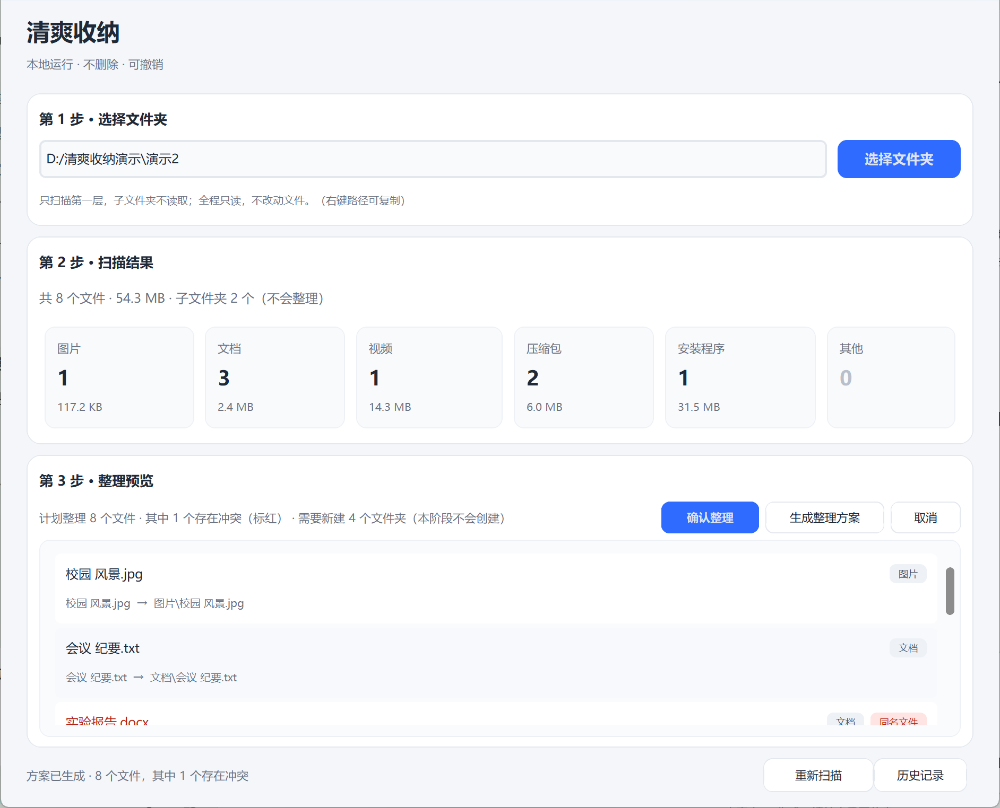
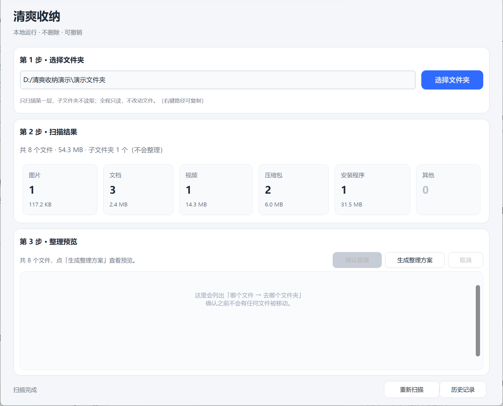
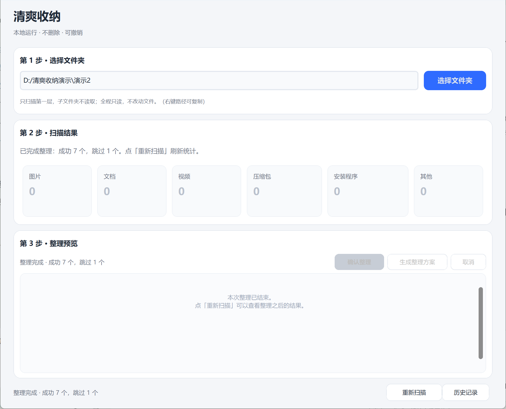
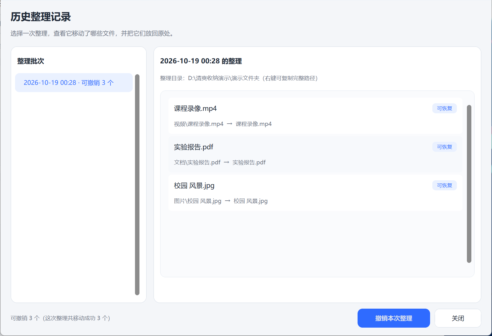

# 清爽收纳

一个**本地运行、不删除、可撤销**的 Windows 文件整理助手。

> 当前版本：v0.6.0（扫描 → 预览 → 确认后整理 → 操作记录 → 历史记录与撤销 → 打包 exe）
> 界面用 Python + CustomTkinter 编写，所有操作都在你自己电脑上完成，不联网、不上传任何文件。

## 现在能做什么

- 选择任意一个文件夹
- 扫描它的**第一层**文件（不进子文件夹）
- 按 图片 / 文档 / 视频 / 压缩包 / 安装程序 / 其他 六类统计数量与占用空间
- 全程只读：不修改、不移动、不删除任何文件
- 适配 Windows 100% / 125% / 150% 显示缩放，窗口不会超出屏幕
- **生成整理方案并预览**：列出每个文件的建议目标位置，标出重名冲突；确认前不动任何文件
- 扫描可中途停止，状态栏实时显示"已找到 N 个文件"
- **确认后真正整理**：逐项复检源/目标、冲突自动跳过、可随时停止
- 每次移动都写入本地操作记录（`%APPDATA%\清爽收纳\records.jsonl`），重启后可读
- 移动用 `os.rename` 原子完成：目标已存在就报错，不覆盖、也不会被"塞进同名文件夹"
- 源文件必须在所选目录的第一层，目标经链接（符号链接/目录联接）解析后仍要在目录内
- **历史整理记录**：按批次列出每一次整理，点开可看该批次实际移动成功的文件
- **撤销本次整理**：把某一次整理移动过的文件搬回原位置；只撤销记录明确为 `moved` 的文件，
  原位置已有同名文件就跳过、绝不覆盖，全程不删除任何文件，可随时停止并准确统计成功/跳过/失败

## 界面预览



扫描与统计：



## 运行环境

- Windows 10 / 11
- 直接运行 EXE：无需安装 Python
- 从源码运行：Python 3.10 及以上（自带 tkinter）

> 如果启动时报 `No module named 'tkinter'`，说明当前这个 Python 没带 tkinter
> （部分精简版/工具内置的 Python 会这样）。请到 python.org 重新安装官方版本，
> 安装时保持默认的 "tcl/tk and IDLE" 勾选，再用它的完整路径执行下面的命令。

## 下载 EXE（普通用户推荐）

**下载地址**：https://github.com/little-stary/qingcheng-shouna/releases/latest

1. 打开上面的下载地址，找到最新版本（`v0.6.0`）
2. 在 **Assets** 区域下载 `清爽收纳.exe`
   - 单文件，约 13.3 MB（13,983,043 字节）
   - 不需要安装 Python，也不需要单独下载依赖
3. 下载后**双击运行**即可
4. 首次运行可能出现 Windows SmartScreen 提示「已保护你的电脑」——这是因为程序**未做代码签名**，
   属正常现象：点 **「更多信息」→「仍要运行」**。
   若杀毒软件拦截，请先确认文件来自本仓库的 Releases 页面，再选择放行

**校验下载是否完整（可选）**：在 PowerShell 中执行

```powershell
Get-FileHash .\清爽收纳.exe -Algorithm SHA256
```

结果应为：

```text
103C31C431D60A77D37526007DB7C150C5FB9B0403C3A9F034F220074F4924A1
```

## 从源码运行

在项目目录下打开命令行（PowerShell 或 CMD），依次执行：

```bat
:: 1. 创建虚拟环境（只需一次）
python -m venv .venv

:: 2. 安装依赖（只需一次）
.venv\Scripts\python.exe -m pip install -r requirements.txt

:: 3. 启动
.venv\Scripts\python.exe main.py
```

如果 `python` 命令不可用，把它换成你的 Python 完整路径，例如
`C:\Users\你的用户名\AppData\Local\Programs\Python\Python314\python.exe`。

## 第一次使用

1. 启动后点 **「选择文件夹」**，选一个你想整理的目录（建议先拿测试目录练手）
2. 第 2 步会显示文件总数和六类统计；这一步**只读**，不会改动任何文件
3. 点 **「生成整理方案」**，预览区会逐条列出「哪个文件 → 去哪个文件夹」
   - 目标位置已有同名文件的，会用红色标出「同名文件」，执行时自动跳过
4. 检查无误后点 **「确认整理」**，确认框里会写明要移动几个、跳过几个
5. 整理完成后，点页脚 **「历史记录」**，选中刚才那次整理，可以 **「撤销本次整理」**，
   把文件搬回原位置

> 撤销只处理记录里明确「已移动」的文件；原位置已有同名文件、目标文件不在了、
> 或状态不确定的，都会跳过并说明原因，绝不覆盖、绝不删除。

整理完成与撤销界面：





## 安全保证

- **不删除**：全程没有任何删除调用，连撤销后变空的分类文件夹都会保留
- **不覆盖**：移动用 `os.rename` 原子完成，目标位置已有同名文件一律报错或跳过
- **可撤销**：每一次整理都按批次记录，可在「历史记录」里把文件整批搬回原位
- **只存本机**：操作记录与日志只写入 `%APPDATA%\清爽收纳\`，程序不联网、不上传任何数据
- **越界拦截**：源文件必须在所选目录的第一层，目标经符号链接 / 目录联接解析后仍必须在目录内

## 运行测试

```bat
.venv\Scripts\python.exe -m unittest discover -s tests -v
```

## 打包成 exe（维护者）

```bat
packaging\build_exe.bat
```

产物是单文件程序 `dist\清爽收纳.exe`（约 13 MB），双击即可运行，不需要安装 Python。
打包配置在 `packaging/qingcheng-shouna.spec`；脚本会自动安装 PyInstaller（仅开发用，
写在 `requirements-dev.txt`，不影响运行时依赖）。发布包内自带 LICENSE 与第三方许可证声明。

## 目录说明

```
main.py              程序入口
app/config.py        分类规则、颜色、尺寸（要加文件类型改这里）
app/core/            纯逻辑，不含任何界面代码
    models.py        数据结构
    classifier.py    扩展名 → 分类
    scanner.py       扫描文件夹（只读，支持进度与取消）
    planner.py       生成整理方案（只计算，不建目录不移动）
    mover.py         执行整理（唯一允许移动文件的模块）
    records.py       操作记录（JSONL，存 %APPDATA%）
    undoer.py        撤销：历史批次、撤销方案、执行与撤销台账
app/ui/              界面
    layout.py        窗口尺寸计算（按屏幕与缩放自适应）
    main_window.py   主窗口
    preview.py       整理预览面板
    history.py       历史记录窗口（查看批次、撤销本次整理）
    widgets.py       卡片、统计格子
    theme.py         字体与间距
app/utils/           错误翻译、日志、路径工具
tests/               单元测试（162 通过 / 2 跳过）
docs/设计说明.md      完整设计文档
CHANGELOG.md         版本更新记录
LICENSE              MIT 许可证（发布前填写年份与署名）
THIRD_PARTY_NOTICES.md / licenses/   第三方组件许可证
packaging/           PyInstaller 配置与一键打包脚本
requirements-dev.txt 打包等开发依赖
```

## 已知限制

- **只整理所选文件夹的第一层**，子文件夹里的内容不会被扫描或移动
- **遇到重名一律跳过**，不会自动改名、也不会覆盖；需要你自己处理后重新整理
- **撤销后空的分类文件夹会保留**（程序承诺不删除任何文件，包括空目录）
- 整理过程中如果程序被强制结束，会留下状态为「未完成」的记录；这类记录**不参与撤销**，
  需要手工处理
- 同一个记录文件不建议多个程序实例同时整理（没有加锁）
- 仅支持 Windows 10 / 11；移动依赖 Windows 的原子改名语义
- 超过数千个文件的大批量整理/撤销没有专门压测，记录逐条落盘，可能偏慢

## 接下来（路线图）

| 阶段 | 内容 |
| --- | --- |
| 一 | 选文件夹、扫描、统计 |
| 二 | 生成整理方案并预览，冲突标红 |
| 三 | 确认后整理、冲突跳过、操作记录 |
| 四 | 历史记录与撤销（本次整理可回退） |
| 五 | PyInstaller 打包 exe、发布前检查 |
| 六（当前） | 发布到 GitHub Releases、代码签名（可选） |

## 问题反馈

**反馈入口**：https://github.com/little-stary/qingcheng-shouna/issues

遇到问题请到上面的 Issues 页面提交，并尽量附上：

1. **复现步骤**：选了哪个文件夹、做了哪几步操作、期望结果与实际结果
2. **日志文件**：`%APPDATA%\清爽收纳\logs\` 目录下的 `app.log`
   （如果这个目录不存在，说明还没触发过错误，只写文字描述也可以）
3. **系统信息**：Windows 10 / 11，以及你是用 Releases 下载的 EXE 还是源码运行
4. 如有必要，附上截图（请先遮掉个人文件名和本地路径）

> 这是个人项目，不承诺固定响应时间，但会尽量处理。

## 许可证

本项目采用 **MIT License**，全文见 [LICENSE](LICENSE)。
Copyright (c) 2026 little-stary。

第三方依赖的许可证见 [THIRD_PARTY_NOTICES.md](THIRD_PARTY_NOTICES.md)。
